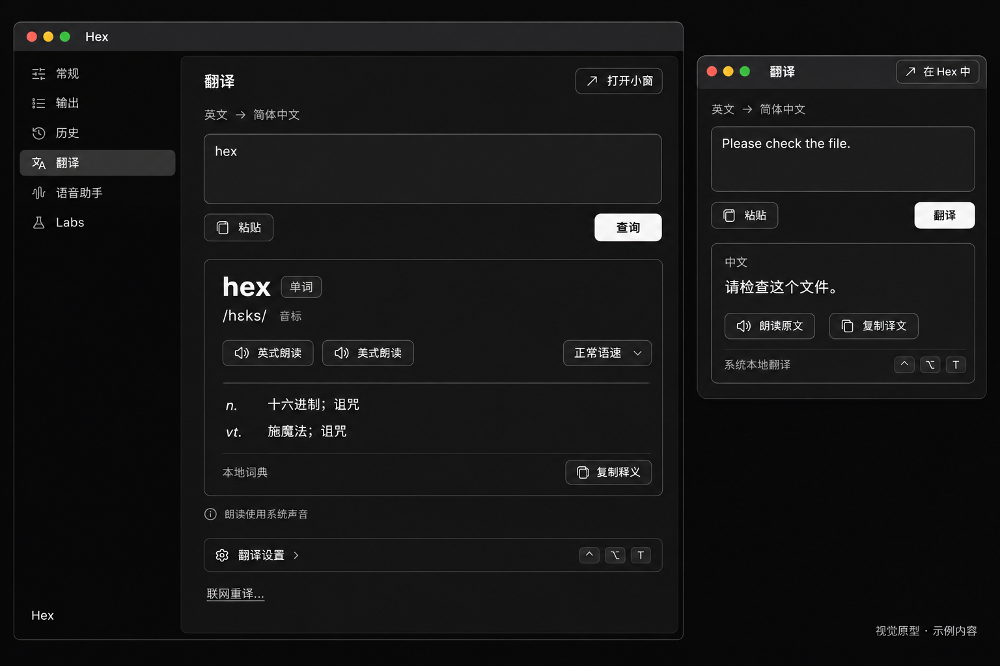

# Hex 翻译视觉原型 v1

日期：2026-11-09。任务：[Linear ZJ-31](https://linear.app/zjlinjie/issue/ZJ-31/hexmacos-本地优先英译中音标朗读与独立快捷键窗口)。需求：[翻译 PRD](../../plans/translation-prd.md)。行为地图：[功能地图](../../features/translation.md)（实施中、待验证，不是本图的原生证明）。

使用 `imagegen` 技能及内置 `image_gen` 工具生成，以仓库已有的 `tests/golden/rune-mac-settings-dark.png` 为视觉参考。[原样提示词](prototype-v1.prompt.md)随图保存。

左侧展示单词查询，右侧展示短句翻译小窗。两者是不同使用场景的对照，不表示同一运行时保留两个不同的当前查询；实际实现仍复用同一内容组件与当前请求状态。

## Rune 组件映射

| 图中元素 | 实施落点 |
| --- | --- |
| 侧栏与高亮项目 | 现有 sidebar、Pane 和 capability/Labs 门控 |
| 输入区 | rune-kit TextArea；局部提交、输入法和粘贴处理 |
| 查询、粘贴、复制、打开小窗 | 现有 Button / IconButton 与 PlatformRequest |
| 词头、音标、词性及释义 | 普通文本布局、Badge 与 Hex card；音标字体回退需验证 |
| 英式/美式朗读 | 次级按钮；只按实际可用的系统声音提供 |
| 正常语速 | 现有 Select；调用系统合成语速参数 |
| 来源、资源说明 | note 或 tone_tag；由真实状态填充 |
| 翻译设置与快捷键 | section、现有折叠逻辑和 keycaps / 快捷键录制组件 |
| 小窗口 | 同一 Rune 进程的独立窗口，复用翻译内容组件 |
| 联网重译… | 次级动作；打开服务、模型和待发文本确认，再显式发送 |

设计沿用 Rune + rune-kit + rune-theme-opencode。原生实现只使用主题 token；图像里的渐变、阴影或字形细节是生成效果，不应成为新增绘制系统的要求。主窗口和小窗各保留一个主要操作。

## 证明范围

这是视觉方案，不是 Rune 渲染、真实运行截图或 golden。图中的词典、音标、译文和系统声音均为示例，不证明资源已安装或接口可用。英美声音缺失、处理中、错误和浅色状态的 fixture 场景已在 `mac-translation-*` 中起草，golden 与原生窗口验证仍待执行。

本文件不授权合并或更新本机安装。独立窗口的激活、焦点及跨 Space 行为仍需在实际 Rune/macOS 会话中验证。
